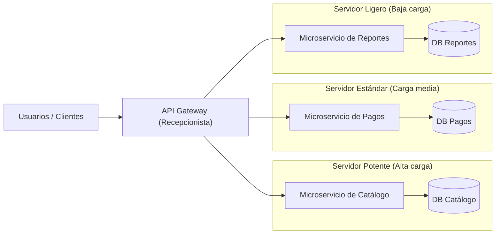

import Figure from '../../../components/Figure.astro';
import Demo from '../../../components/Demo.astro';

## ¿Qué es el Backend?

El **backend** es el motor invisible que hace funcionar a cualquier aplicación, es decir, es el corazón o lógica de tu aplicación, encargada de procesar datos, comunicarse con la base de datos, gestionar peticiones que vienen desde el frontend, validar reglas de negocio y devolver respuestas al frontend.

Para entenderlo mejor tenemos que separar el backend del frontend. El **frontend** es todo lo que el usuario ve e interactúa; normalmente se construye con HTML, CSS, JavaScript y librerías de diseño. El detalle importante es que el frontend se ejecuta en el navegador del usuario.

Por otro lado, como ya se mencionó, el backend es el corazón de la aplicación; a diferencia del frontend que se ejecuta en el navegador del usuario, el backend suele ejecutarse en los servidores, esto con el propósito de no exponer la lógica del negocio a cualquier persona; es por esto que normalmente se busca proteger el backend ante vulnerabilidades que podrían exponer sus funciones. Se suelen utilizar lenguajes ligeros y de alto nivel como Python, Node.js, Java, Rust o similares.

<Demo
  src="/classes/introduccion-web-movil/07-backend/flujo-backend.html"
  title="Flujo de peticiones y respuestas entre Usuario, Frontend, Backend y Base de datos"
  height={190}
/>

{/* GENERADO: "(AÑADIR AQUÍ UN DIAGRAMA DONDE SE MUESTRE COMO EL USUARIO INTERACTUA CON EL FRONTEND, EL FRONTEND ENVIA PETICIONES AL BACKEND, EL BACKEND A LA BASE DE DATOS Y LUEGO DE VUELTA, EL DIAGRAMA DEBE SER SIMPLE, CADA PARTE DEBE MOSTRARSE COMO RECTANGULOS CON BORDES SUAVIZADOS, DEBE EXISTIR UNA ANIMACION QUE MUESTRE COMO LA SEÑAL VIAJA DE UN LADO A OTRO, LA ANIMACION NO DEBE SER MUY RAPIDA PARA PODER VISUALIZARLA CORRECTAMENTE, CADA RECTANGULO DEBE TENER SU NOMBRE DENTRO, LA BASE DE DATOS ES LA UNICA QUE SE TIENE QUE MOSTRAR COMO UN CILINDRO EN VEZ DE RECTANGULOS)" */}

Como podemos ver en la animación, el usuario interactúa clickeando botones en el frontend, el frontend "escucha" esos clicks y le envía las peticiones al backend, el backend luego se comunica con la base de datos, la base de datos devuelve los datos crudos, el backend se encarga de preparar los datos para devolverlos al frontend.

## Arquitectura de software en Web Development

Una **arquitectura de software** define cómo se organizan los componentes de un sistema y cómo se comunican entre sí. Esta estructura es la que define la forma del backend y es fundamental porque permite escalar, mantener y reutilizar el código a largo tiempo; los más importantes son:

### Arquitectura Cliente-Servidor

Es la arquitectura más básica y el pilar de la web; su funcionamiento es muy directo.

- El **cliente** (aplicación web o app móvil) toma la iniciativa y envía peticiones, conocidas como peticiones HTTP, al servidor.
- El **servidor** recibe la orden, hace su trabajo y responde entregando datos o vistas, generalmente en formato HTML o JSON.

<Figure
  src="/classes/introduccion-web-movil/07-backend/arquitectura-cliente-servidor.png"
  alt="Diagrama de arquitectura Cliente-Servidor mostrando el envío de Request del cliente al servidor y la respuesta Response"
  side="full"
/>

### Arquitectura 3 Capas

La idea principal es separar el código en 3 capas distintivas, las cuales tienen distintas responsabilidades.

- **La capa de presentación** corresponde al frontend, es decir, corresponde a la interfaz con la que interactúa el usuario.
- **La capa de lógica** corresponde al backend; se encarga de recibir solicitudes, hacer cálculos, solicitar datos a la base de datos y aplicar las reglas del negocio.
- **La capa de datos** corresponde a la base de datos, es el lugar donde se almacenan los datos.

<Figure
  src="/classes/introduccion-web-movil/07-backend/arquitectura-tres-capas.png"
  alt="Diagrama de arquitectura de tres capas (Three Tier architecture): Presentation (web server), Application y Database"
  side="full"
/>

### Arquitectura microservicios

Esta arquitectura se enfoca principalmente en el backend; la idea principal es separar el backend en distintos servicios pequeños e independientes. Cada uno de estos servicios se encarga de una sola tarea, teniendo su propia lógica e incluso su propia base de datos exclusiva; como los servicios están separados tienen que comunicarse por APIs, generalmente se suele utilizar una API central llamada **API Gateway**, la cual funciona como recepcionista, recibiendo las peticiones del usuario y redirigiéndolas al servicio correcto.

Lo más importante de la arquitectura microservicios es que es altamente escalable y flexible; su mayor ventaja es que, al existir separación del código, cada microservicio puede vivir dentro de un servidor distinto, permitiendo que los microservicios menos usados tengan servidores menos potentes, mientras que los microservicios principales tengan servidores potentes y rápidos.



{/* GENERADO: "(AÑADIR AQUÍ UN DIAGRAMA SIMPLE QUE MUESTRE COMO FUNCIONA UNA ARQUITECTURA MICROSERVICIOS, DEBE SER CLARA LA SEPARACION DE RESPONSABILIDADES Y CARGAS, Y ADEMAS MOSTRARSE LA API GATEWAY AL CENTRO)" */}

## Entornos de Ejecución

{/* REVISAR: En el PDF el título incluye la indicación "(Debe ser titulo de seccion, los demas deben ser sub titulos)"; se aplicó la jerarquía solicitada (## para la sección y ### para los subtítulos) y se omitió la nota entre paréntesis del encabezado visible. */}

Hasta ahora hemos visto qué es el backend e incluso algunas arquitecturas para proyectos, pero ahora debemos hacernos la pregunta: ¿Dónde se ejecuta el backend? Existen varias formas de ejecutar un backend, cada una con su propósito y razón de uso.

### Entorno local

El entorno más simple de todos, es ideal para probar tu código antes de subirlo a producción; todo se ejecuta localmente dentro de tu computadora, en una dirección conocida como el `str::"localhost"` seguido de un puerto. Normalmente se ejecuta directamente desde consola con `uvicorn`, `npm` o `nest`.

### Servidor Físico o VPS (Virtual Private Server)

A diferencia del `localhost`, ahora vamos a ejecutar el backend en un servidor real o una máquina virtual dedicada; debido a que estamos corriendo el backend en un entorno dedicado podremos obtener un mayor rendimiento, pero como ahora tenemos control total, tendremos que realizar las configuraciones del servidor de manera manual, como instalar todo tipo de dependencias, configurar procesos y certificados de seguridad.

### Contenedores y Orquestadores

Es la forma moderna de asegurar un despliegue eficiente; utilizando apps de contenedores como **Docker** puedes empaquetar tu código con todas sus dependencias para que se ejecute todo de forma aislada. Esto permite que compartir tu backend sea muy simple, ya que si funciona en tu máquina también funcionará en otra.

Por otro lado, los **orquestadores** coordinan múltiples contenedores en *"clusters"*, lo cual facilita mucho el despliegue, escalado y la portabilidad.

### Cloud Computing

Se podría decir que es el más fácil a nivel "físico"; consiste en ejecutar el backend completamente en la nube mediante servicios de paga como lo puede ser Google Cloud, AWS, Railway, etc. A diferencia de los otros entornos, aquí no tenemos acceso directo a los servidores, lo que elimina completamente la necesidad de hacer mantenimiento o escalar, ya que estos servicios suelen tener un escalado automático. Sus ventajas principales son la alta disponibilidad, escalabilidad automática y mantenimiento automático.

<Demo
  src="/classes/introduccion-web-movil/07-backend/consulta-nube.html"
  title="Proceso de una consulta web a un backend y base de datos en la nube"
  height={250}
/>

{/* GENERADO: "(AÑADIR AQUÍ UNA ANIMACION QUE MUESTRE EL PROCESO DE UNA CONSULTA A UNA PAGINA WEB CON SU BACKEND EN LA NUBE, MOSTRAR UN CURSOR HACIENDO CLICK EN UN BOTON, LUEGO DEL CLICK SE LANZA UNA SEÑAL A UNA NUBE, CUANDO LA SEÑAL LLEGUE A LA NUBE SE TIENE QUE HACER UN ZOOM EL CUAL MUESTRE UN BLOQUE DE CODIGO SIENDO EJECUTADO, LA EJECUCION DEBE SER MOSTRANDO COMO LAS LINEAS DE CODIGO SE VAN ENCENDIENDO, AL LLEGAR A LA MITAD DEL CODIGO SE LANZA UNA SEÑAL HACIA UN CILINDRO QUE REPRESENTA LA BASE DE DATOS, LA BASE DE DATOS RECIBE LA SEÑAL Y LA DEVUELVE AL BLOQUE DE CODIGO, UNA VEZ QUE EL BLOQUE DE CODIGO RECIBE LA SEÑAL DE LA BASE DE DATOS SE CONTINUA EJECUTANDO, UNA VEZ QUE TERMINA SE HACE UN ZOOM OUT Y SE MUESTRA COMO LA NUBE DEVUELVE LA SEÑAL AL CURSOR QUE HIZO CLICK, FINALMENTE SE MUESTRA EN PANTALLA COMO EL CURSOR RECIBE UN \"Hello world\")" */}

Como podemos ver en la animación, nuestro backend y base de datos existen en la nube; al interactuar con la interfaz se dispara una solicitud al backend, el backend procesa la solicitud, pide datos a la base de datos y luego le devuelve la información al cliente. A diferencia de hostear el backend en tu servidor, si tu backend empezara a recibir miles de consultas, el servicio en la nube sería quien se encargaría de adaptarse a la demanda; tú no tendrías que hacer nada más que mirar.

## Bases de Datos

{/* REVISAR: En el PDF el título incluye la indicación "(titulo de seccion)"; se aplicó el nivel de encabezado ## y se omitió la nota entre paréntesis del encabezado visible. */}

Una **base de datos** es un sistema que permite almacenar, organizar y recuperar información de manera eficiente. Son un componente principal para la gran mayoría de backends modernos. Existen dos grandes familias de bases de datos: **SQL** y **NoSQL**.

### Bases de Datos SQL

Conocidas como **bases de datos relacionales**, son el modelo clásico y más utilizado históricamente. Organizan la información utilizando tablas las cuales tienen filas y columnas; estas bases de datos utilizan un lenguaje estandarizado llamado **SQL** (*Structured Query Language*) para realizar consultas, insertar datos, etc. Se caracterizan por mantener integridad entre los datos; debido a que no existe flexibilidad entre registros, si una columna se llama `str::"edad"` solo puedes insertar valores numéricos, se permite dejar la casilla vacía pero igualmente ocupará espacio en memoria. La principal ventaja de las SQL es su madurez, lenguaje estandarizado, posibilidad de `JOIN`s y que la mayoría certifican **ACID**.

<Figure
  src="/classes/introduccion-web-movil/07-backend/tabla-sql-customer-details.png"
  alt="Tabla relacional Customer_Details con las columnas Customer_id, Name, Address y Age y seis filas de clientes"
  side="full"
/>

### Bases de Datos NoSQL

Nacidas para solucionar los problemas de escalado y flexibilidad de las bases de datos SQL, las **NoSQL** (*Not only SQL*) existen en diversos formatos; normalmente evitan el uso de tablas (con excepciones), guardando los datos como documentos JSON. Son extremadamente flexibles ya que permiten mezclar tipos de datos sin ningún problema, y destacan especialmente por su escalabilidad horizontal, lo que permite distribuir los datos de mejor manera.

Como se mencionó, las bases de datos NoSQL existen en muchas "formas y colores"; a diferencia de las SQL que normalmente todas utilizan tablas, las NoSQL nacen de la necesidad, y los tipos más comunes son:

- **Clave:valor**, bases de datos que se enfocan en la velocidad; guardan los datos y los buscan mediante su clave. Su principal desventaja es que no permite buscar por datos dentro del "valor".

<Figure
  src="/classes/introduccion-web-movil/07-backend/nosql-clave-valor.png"
  alt="Estructura de base de datos clave:valor con claves K1 a K5 asociadas a sus valores"
  side="full"
/>

- **Documentales**, parecidas a las clave:valor, las documentales guardan los datos en estructuras llamadas "Documentos", los cuales son grupos de datos, generalmente clave:valor guardados como JSON; destacan por su alta flexibilidad al guardar datos pero sufren al intentar hacer búsquedas complejas: al no poseer `JOIN`s la estructura de obliga a realizar muchas consultas o guardar datos duplicados. {/* REVISAR: posible error, propuesta: "la estructura te obliga a realizar muchas consultas" */}

<Figure
  src="/classes/introduccion-web-movil/07-backend/nosql-documental.png"
  alt="Jerarquía de una base de datos documental: Instance (primary), Database(s), Collection(s), Document(s) en formato JSON y Field(s)"
  side="full"
/>

- **De grafos**, diseñadas con un enfoque en las relaciones; guardan los datos en nodos los cuales se conectan a otros nodos mediante vértices. {/* REVISAR: posible error conceptual, propuesta: "mediante aristas" (en grafos los nodos son los vértices y las conexiones entre ellos son las aristas) */} Su mayor ventaja es que permiten asignarle valores a las conexiones, lo que las hace perfectas para todo tipo de aplicación que requiera contexto entre los datos; principalmente se usan en las redes sociales para permitir búsquedas como *"Los amigos de los amigos de Juan"*, los cuales necesitarían múltiples `JOIN`s en las bases de datos normales.

<Figure
  src="/classes/introduccion-web-movil/07-backend/nosql-grafos.png"
  alt="Diagrama de base de datos de grafos con nodos Users, Cities, Teams y Stadiums conectados mediante relaciones Likes, Stadium Cities y Home Stadium"
  side="full"
/>

- **Column-Wide o Columnares**, se parecen a las SQL en el sentido de que guardan los datos en tablas; la diferencia es que tienen una gran flexibilidad de datos, permitiendo que algunas filas guarden ciertos valores mientras otras guardan valores distintos. Su flexibilidad además permite que algunas filas tengan menos datos que otras, solucionando el problema de espacios vacíos ocupando memoria en las SQL.

<Figure
  src="/classes/introduccion-web-movil/07-backend/nosql-columnar.png"
  alt="Estructura de base de datos columnar con filas Row A y Row B compuestas por columnas y valores"
  side="full"
/>

## Arquitectura REST y Endpoints

Cuando el frontend y el backend se comunican, lo hacen bajo ciertas reglas. **REST** es el estándar más común para crear APIs.

En el modelo REST los recursos se presentan como URLs; mediante una interfaz uniforme de los métodos del protocolo HTTP se entregan las respuestas en formato JSON y se utilizan *"status codes"* o códigos de estatus para indicar si todo salió bien o hubo un error. Los métodos principales son:

- `GET`: sirve para listar todos los elementos o obtener alguno específico.

```http
GET /api/usuarios/1 HTTP/1.1

HTTP/1.1 200 OK
Content-Type: application/json

{ "id": 1, "nombre": "Ana" }
```

- `POST`: Se utiliza para crear un nuevo registro.

```http
POST /api/usuarios HTTP/1.1
Content-Type: application/json

{ "nombre": "Carlos" }

HTTP/1.1 201 Created
{ "id": 2, "nombre": "Carlos" }
```

- `PUT`/`PATCH`: Se usan para actualizar recursos ya existentes.

```http
PATCH /api/usuarios/2 HTTP/1.1
Content-Type: application/json

{ "nombre": "Carlos Gómez" }

HTTP/1.1 200 OK
{ "id": 2, "nombre": "Carlos Gómez" }
```

- `DELETE`: Se utiliza para eliminar información.

```http
DELETE /api/usuarios/2 HTTP/1.1

HTTP/1.1 204 No Content
```

{/* GENERADO: "(AÑADIR UN PEQUEÑO BLOQUE DE CODIGO LUEGO DE CADA METODO PARA MOSTRAR COMO SE VEN EN LA PRACTICA)" */}
{/* REVISAR: interpreté "(AÑADIR UN PEQUEÑO BLOQUE DE CODIGO LUEGO DE CADA METODO PARA MOSTRAR COMO SE VEN EN LA PRACTICA)" como ejemplos de peticiones y respuestas HTTP con URL del recurso, código de estado y cuerpo JSON debajo de cada método. */}

## Seguridad del Backend

Como el backend es una de las partes más importantes de la app, es necesario protegerla para que nadie pueda hacer lo que quiera con él. Para esto se utilizan distintas técnicas o tecnologías:

- **JWT (JSON WEB TOKEN) y Sesiones**: Para manejar los inicios de sesión se utilizan tokens portables los cuales viajan entre el cliente y el servidor, o también guardando la sesión directamente en el servidor.
- **HTTPS**: El uso de HTTPS es obligatorio para cifrar la comunicación. Además se deben proteger las credenciales utilizando *"secrets"* y variables de entorno para que nunca queden expuestas en el código.
- **CORS**: Permite tener un control sobre qué páginas web externas tienen permiso de hacerle peticiones a tu API; esto permite que la API rechace cualquier solicitud de una página que tú no hayas aceptado.
- **Rate limiting y Logging**: Se limitan las peticiones por segundo y se registra la actividad para prevenir ataques y abusos en el sistema.

## Frameworks populares

Para no tener que programar todo desde cero existen *"frameworks"* (marcos de trabajo) los cuales traen herramientas y código listo. La elección depende del lenguaje:

- **Express**: Basado en Node.js. Es minimalista, aprovecha todo el ecosistema NPM y es ideal para crear APIs ligeras.
- **NestJS**: También usa Node.js, pero ofrece una arquitectura modular (con Inyección de Dependencias), pensado para crear APIs escalables y ordenadas.
- **FastAPI**: Basado en Python. Es sumamente rápido, utiliza tipado, genera documentación automática (OpenAPI) y es excelente para microservicios o proyectos de Inteligencia Artificial/Machine Learning.
- **Django REST**: Basado en Python. Es muy productivo porque incluye un ORM potente (herramienta para manejar la base de datos), ideal para crear operaciones de creación, lectura, actualización y borrado (CRUD) muy rápido.
- **Spring Boot**: Basado en Java. Es increíblemente robusto y es el estándar *"Enterprise"* para construir sistemas corporativos muy grandes.
