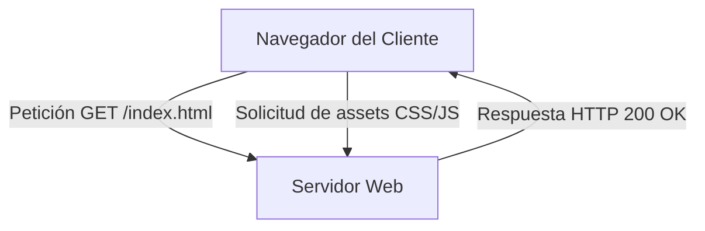

*Contenido de ejemplo*

## 1. Figuras y Maquetación Flotante

<Figure
  src="/classes/web-intro/04-todos-los-bloques/ejemplo.svg"
  alt="Ejemplo de figura flotante"
  caption="Figura flotante a la derecha con texto fluido"
  side="right"
/>

Este párrafo acompaña a la figura flotante a la derecha. Cuando el ancho de pantalla es superior a 640 píxeles, la imagen flota hacia el lateral permitiendo que el texto fluya de forma natural alrededor de ella. Al reducirse a pantallas móviles, el componente se reorganiza para ocupar el ancho completo sin desbordar el contenedor del artículo.

La maquetación fluida garantiza que las explicaciones detalladas y los diagramas visuales puedan convivir armoniosamente sin interrumpir la lectura continua del estudiante.

### Fila de elementos lado a lado

<Row>
  <Figure
    src="/classes/web-intro/04-todos-los-bloques/ejemplo.svg"
    alt="Vista A"
    caption="Componente izquierdo"
    side="full"
  />
  <Figure
    src="/classes/web-intro/04-todos-los-bloques/ejemplo.svg"
    alt="Vista B"
    caption="Componente derecho"
    side="full"
  />
</Row>

## 2. Código con Título y Resaltado de Líneas

A continuación se muestra un bloque de código estructurado con Expressive Code:

```html title="index.html" {2-3}
<!doctype html>
<html lang="es">
  <head>
    <meta charset="utf-8" />
    <title>Página de ejemplo</title>
  </head>
  <body>
    <h1>Bienvenido a la Web</h1>
  </body>
</html>
```

En el texto explicativo, la clase `cls::MyList` define un atributo `kw::private` que almacena una `var::strategy` inicializada en `const::null`. Al invocar el método `fn::sort()`, la salida genera un elemento `tag::div` con el atributo `attr::class` y el mensaje `str::"hola"`, ejecutando internamente el comando `npm install`.

## 3. Fórmulas Matemáticas con KaTeX

En el desarrollo web y ciencias de la computación también conviven formulaciones matemáticas. Por ejemplo, la equivalencia masa-energía se escribe de forma inline como $E=mc^2$.

Por otra parte, la suma de los primeros $n$ números naturales se expresa como fórmula en bloque destacado:

$$ \sum_{i=1}^{n} i = \frac{n(n+1)}{2} $$

## 4. Diagramas con Mermaid

Los flujos y arquitecturas se representan mediante diagramas declarativos de Mermaid:



## 5. Tablas de Contenido

| Elemento | Estándar | Propósito Principal |
|---|---|---|
| `<article>` | HTML5 | Sección autocontenida de contenido |
| `<aside>` | HTML5 | Contenido relacionado tangencial |
| `<nav>` | HTML5 | Bloque de enlaces de navegación |

## 6. Demostraciones y Contenido Multimedia

### Demostración interactiva en iframe

<Demo
  src="/classes/web-intro/04-todos-los-bloques/demo.html"
  title="Demostración de componente web embebido"
  height={320}
/>

### Video explicativo

<Video
  url="https://www.youtube.com/watch?v=dQw4w9WgXcQ"
  title="Video ilustrativo sobre estándares web"
/>

## 7. Gráficos Interactivos con Observable Plot

<Graph
  type="line"
  data={[
    { x: 1, y: 15 },
    { x: 2, y: 28 },
    { x: 3, y: 22 },
    { x: 4, y: 45 },
    { x: 5, y: 38 },
    { x: 6, y: 55 }
  ]}
  x="Tiempo transcurrido (s)"
  y="Tasa de transferencia (MB/s)"
  title="Rendimiento de descarga de paquetes"
/>

## 8. Bloques de Información y Margen Lateral

<Side>
  <Callout type="note">
    Esta es una nota informativa en columna lateral (Side) para acompañar la lectura en pantallas amplias.
  </Callout>
</Side>

El uso de columnas marginales permite añadir anotaciones pedagógicas sin interrumpir la línea principal de lectura. En resoluciones grandes, esta nota se ubica a la derecha, mientras que en pantallas móviles o intermedias se integra de manera lineal y fluida.

<Callout type="warning">
  Atención: Verifique siempre la compatibilidad de navegadores antes de utilizar APIs experimentales.
</Callout>

<Callout type="addition">
  Esta adición complementaria fue aportada para profundizar en el impacto del diseño web responsivo.
</Callout>

## 9. Arquitectura y Rendimiento Web

El análisis de rendimiento en aplicaciones web comprende la optimización de recursos estáticos, la minimización de bloqueos en el hilo principal y el despliegue eficiente mediante redes de distribución de contenido (CDN).

Al planificar una solución integral, resulta crucial medir el tiempo de respuesta inicial del servidor, la velocidad de procesamiento del DOM y el consumo de memoria en dispositivos móviles.

### Técnicas de Optimización

1. Reducción y compresión de hojas de estilo e imágenes en formatos modernos.
2. División de código en fragmentos asíncronos bajo demanda (*code-splitting*).
3. Cacheo granular en el cliente con cabeceras HTTP adecuadas y service workers.

## 10. Accesibilidad y Estándares Internacionales

La inclusión digital demanda que cada interfaz web cumpla con las pautas de accesibilidad para el contenido web (WCAG). Esto asegura que personas con diferentes capacidades sensoriales o motrices puedan percibir, entender y navegar el contenido sin obstáculos.

Los contrastes adecuados de color, la navegación por teclado completa y la compatibilidad con lectores de pantalla no son características opcionales, sino requisitos esenciales de la ingeniería de software actual.

### Principios Fundamentales WCAG

- **Perceptible:** La información y los componentes de la interfaz de usuario deben presentarse a los usuarios de forma que puedan percibirlos.
- **Operable:** Los componentes de la interfaz de usuario y la navegación deben ser completamente operables mediante teclado y mecanismos alternativos.
- **Comprensible:** La información y las operaciones de la interfaz de usuario deben ser claras, predecibles y comprensibles.
- **Robusto:** El contenido debe ser suficientemente robusto para ser interpretado con fiabilidad por una amplia variedad de agentes de usuario, incluidas las tecnologías de asistencia.

## 11. Conclusiones y Próximos Pasos

El dominio de los bloques estructurales y la maquetación semántica constituye el cimiento de cualquier desarrollo informático orientado a la web moderna. A lo largo de los siguientes módulos profundizaremos en la interactividad avanzada, arquitecturas cliente-servidor y sistemas distribuidos.
